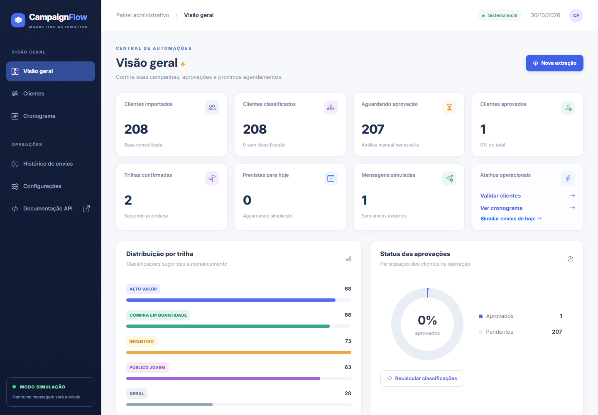
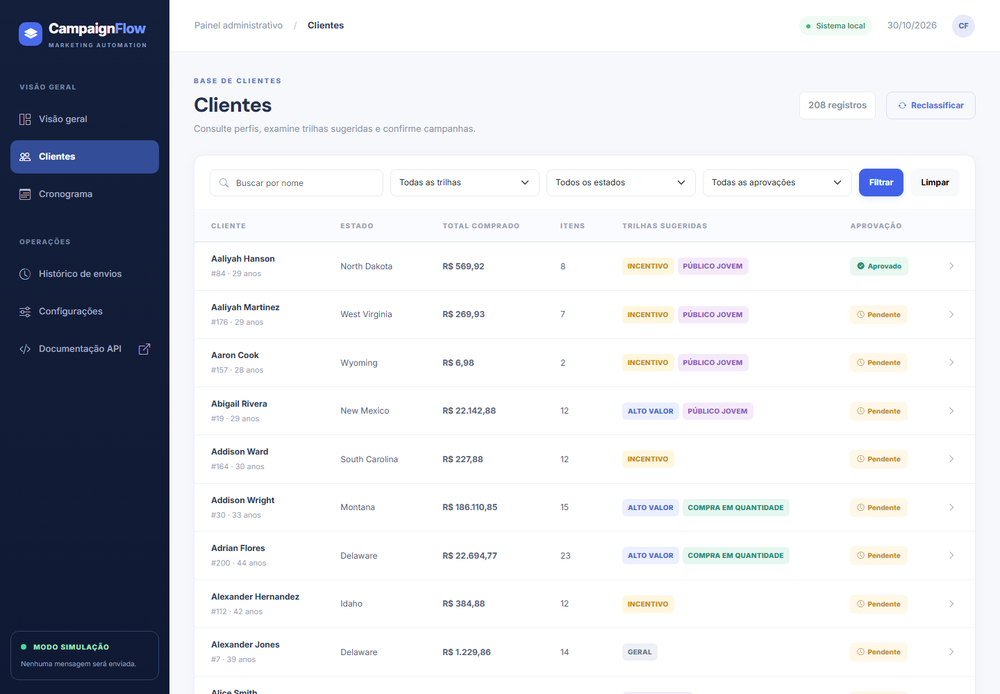
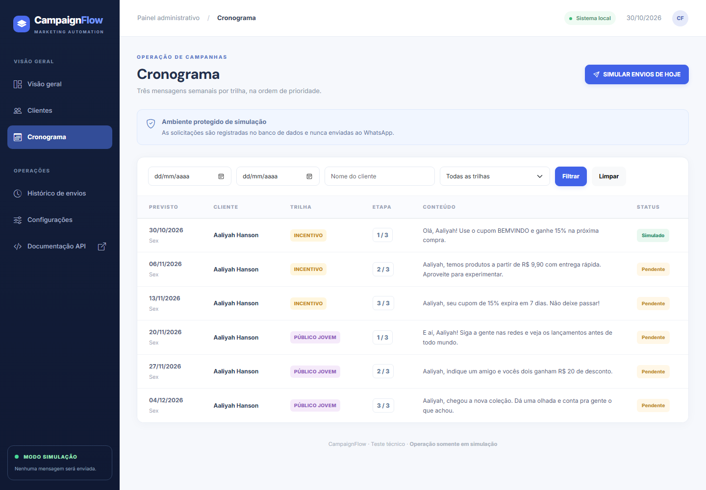
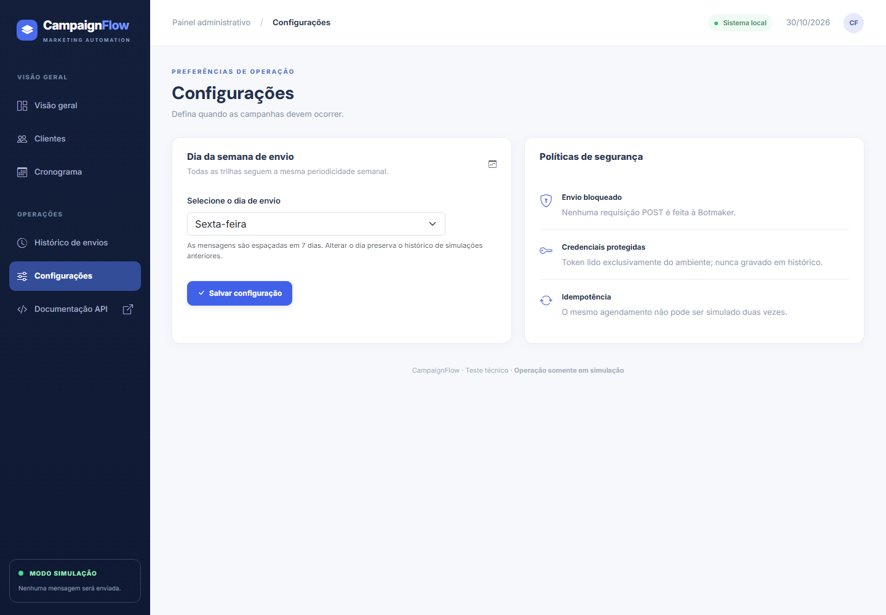

# CampaignFlow

**Sistema de gestão de campanhas para e-commerce, com importação da DummyJSON, segmentação e simulação de WhatsApp.**

Projeto de teste técnico para a vaga de Desenvolvedor Júnior (Automações e Integrações), BEST LIFE GESTÃO DE PESSOAS E SERVIÇOS LTDA.

> **Segurança:** nenhum envio real de mensagens é executado. A plataforma registra apenas a estrutura de uma requisição simulada. A aplicação foi projetada para uso local em ambiente de avaliação e **não tem autenticação de usuários**.

## 1. O que o sistema faz

- Importa **todos** os clientes e carrinhos de `https://dummyjson.com/users` e `https://dummyjson.com/carts`, percorrendo páginas por `limit` e `skip`, com timeout, validação de respostas e logs.
- Armazena os registros de resposta da API em arquivos JSON de extração únicos, em `data/raw/AAAA-MM-DD/`.
- Consolida clientes, carrinhos e produtos em banco SQLite, em transação; armazena valores monetários com `Decimal`/`Numeric(14,2)` e soma a **quantidade de unidades** dos produtos, não a de SKUs.
- Mantém clientes sem compras com total R$ 0,00 e 0 itens; evita duplicação por IDs únicos.
- Classifica clientes em todas as trilhas cujas regras atendem ao perfil, ordenadas por prioridade; **Geral** é exclusiva para quem não atende às outras regras.
- Permite revisar, adicionar, remover e confirmar manualmente trilhas em cada perfil.
- Gera, **só após aprovação**, três mensagens semanais por trilha, em ordem de prioridade e nunca duas simultâneas para o mesmo cliente.
- Exibe a jornada do cliente a partir dos agendamentos reais, com progresso, próxima mensagem e previsão de conclusão.
- Permite selecionar o dia semanal e reagenda mensagens pendentes, preservando as que já foram simuladas.
- Monta e armazena uma **simulação** para mensagens previstas para a data atual, sem qualquer POST para WhatsApp e sem gravar token.
- Exibe painel com números reais do SQLite, distribuição de trilhas, aprovações, clientes, cronograma, data e volume da última extração concluída e detalhes técnicos de cada simulação.
- Permite filtrar o histórico por nome, intervalo de datas, trilha e status e exportar os resultados filtrados em CSV.

## 2. Tecnologias

Python 3.11+, FastAPI, Uvicorn, SQLAlchemy 2.x, SQLite, Jinja2, Bootstrap 5, JavaScript, HTTPX, pytest, python-dotenv e Starlette SessionMiddleware.

## 3. Arquitetura

```text
campaignflow/
├── app/
│   ├── main.py                         # Inicialização FastAPI e /health
│   ├── database.py                     # Sessão SQLAlchemy e SQLite
│   ├── models/entities.py              # Modelos e restrições
│   ├── routers/pages.py                # Telas, formulários e APIs de leitura
│   ├── services/
│   │   ├── clock.py                    # Data local (America/Sao_Paulo)
│   │   ├── dummyjson_service.py        # Paginação HTTP e arquivos de extração
│   │   ├── customer_service.py         # Validação e consolidação
│   │   ├── classification_service.py   # Regras reproduzíveis
│   │   ├── schedule_service.py         # Aprovação e programação semanal
│   │   ├── whatsapp_service.py         # Montagem offline, sem POST
│   │   └── message_seed.py             # 15 mensagens do enunciado
│   ├── templates/                      # Jinja2 SSR
│   └── static/css, static/js/          # Visual responsivo e confirmação
├── docs/screenshots/                   # Capturas reais da aplicação em execução
├── tests/                              # Testes automatizados com mocks
├── scripts/seed_demo.py                # Exemplo local opcional
├── data/raw/.gitkeep                   # JSONs gerados são ignorados pelo Git
├── .github/workflows/test.yml
├── .gitignore
├── Dockerfile
├── docker-compose.yml
├── requirements.txt
└── README.md
```

## Capturas da aplicação

Imagens capturadas com a aplicação rodando localmente no navegador, usando a interface real e os dados de teste da DummyJSON. Não são mockups.

### Visão geral



### Clientes



### Cronograma



### Configurações



## 4. Pré-requisitos

Python 3.11 ou superior e pip. Internet necessária **ao executar uma nova extração** do DummyJSON e para carregar estilos Bootstrap/ícones das CDNs; o backend roda localmente sem acesso à internet se houver dados cadastrados. Não é necessário contratar WhatsApp nem cadastrar token para simular.

## 5. Instalação — Windows (PowerShell)

```powershell
cd campaignflow
py -3 -m venv .venv
.\.venv\Scripts\Activate.ps1
python -m pip install -r requirements.txt
python -m uvicorn app.main:app --reload --host 127.0.0.1 --port 8000
```

Acesse **http://127.0.0.1:8000**.

Se o PowerShell bloquear o script de ativação, execute diretamente `& .\.venv\Scripts\python.exe -m uvicorn app.main:app --reload` no PowerShell.

## 6. Instalação — Linux / macOS

```bash
cd campaignflow
python3 -m venv .venv
source .venv/bin/activate
python -m pip install -r requirements.txt
python -m uvicorn app.main:app --reload --host 127.0.0.1 --port 8000
```

### Alternativa Docker

```bash
cd campaignflow
docker compose up --build
```

Acesse **http://127.0.0.1:8000**. Em Docker, o servidor está publicado para o host na porta 8000, mas a aplicação ainda não tem login. Não a exponha publicamente.

## 7. Variáveis de ambiente

| Nome | Uso |
| --- | --- |
| `DATABASE_URL` | URL do banco SQLite. Padrão sem `.env`: arquivo `data/campaignflow.db` do projeto. |
| `SESSION_SECRET` | Segredo para assinar cookies de sessão/CSRF. Gere um valor longo antes de utilizar. |
| `WHATSAPP_API_TOKEN` | Token de acesso Botmaker v2 lido do ambiente para montar a simulação. Nunca é enviado nem salvo no histórico; pode ficar vazio no modo offline. |
| `BOTMAKER_CHANNEL_ID` | ID de canal da conta Botmaker, opcional na simulação; sem ele aparece `<CONFIGURAR_CHANNEL_ID>`. |

Nenhum arquivo `.env` é necessário para iniciar a demonstração. Se precisar personalizar as variáveis, crie `.env` localmente; ele é ignorado pelo Git e não deve ser publicado. Nenhum token precisa ser configurado.

## 8. Como usar

1. Acesse a **Visão geral** e clique em **Nova extração**. O sistema busca as duas fontes completamente, salva JSONs únicos, consolida e classifica.
2. Acesse **Clientes**, filtre por nome, estado, trilha ou status; abra um perfil.
3. Marque ou desmarque as trilhas (inclusive uma trilha adicionada manualmente), então pressione **Confirmar trilhas**. Sem confirmação não há cronograma.
4. Em **Configurações**, selecione o dia semanal. Por padrão, segunda-feira.
5. Em **Cronograma**, confira todas as mensagens na sequência. Utilize **SIMULAR ENVIOS DE HOJE** quando houver mensagens pendentes para a data atual.
6. Abra **Histórico de envios**, filtre por nome, período, trilha ou status; consulte os detalhes técnicos ou exporte os resultados filtrados em CSV UTF-8 com BOM. O arquivo mantém as 11 colunas originais e acrescenta `Número da mensagem`, `Data prevista`, `Canal Botmaker` (CONFIGURADO/PLACEHOLDER) e `Requisição JSON`. A nova data prevista vem do cronograma, distinta da data e hora real da simulação; a requisição HTTP inteira fica em uma célula JSON, em ordem de execução programada e com credenciais redigidas.

Cada um dos cinco segmentos tem exatamente três mensagens, armazenadas em `campaign_messages`. A classificação automática pode sugerir várias trilhas; **Geral** é usada exclusivamente na ausência das outras condições. Alto valor e incentivo são mutuamente exclusivos pelos limites de gasto, portanto um cliente pode atender no máximo três regras automáticas. O operador pode revisar as sugestões e incluir outras trilhas manualmente. O cronograma utiliza a ordem de prioridade definida no teste.

### Carga demonstrativa opcional, sem APIs externas

```bash
python -m scripts.seed_demo
```

Adiciona três clientes de exemplo, com IDs próprios distintos da DummyJSON e com um cliente aprovado. **Não substitui a importação real**, nem é executada automaticamente na inicialização. Para iniciar com banco limpo, remova `data/campaignflow.db` enquanto o servidor estiver parado.

## 9. Testes

```bash
python -m pytest -q
```

Cobertura de cenários: paginação completa, falhas HTTP, JSON inválido, arquivo não sobrescrito, deduplicação, valores e quantidades, zero compras, limites e classificação em múltiplas trilhas, motivos e prioridades, alterações com nova aprovação, aprovação e inclusão manual de trilhas, reagendamento, sequência sem sobreposição, personalização, telefone, montagem HTTP com token redigido, dupla simulação bloqueada, proibição de POST, filtros e exportação CSV (colunas, integridade do cronograma, placeholders e credenciais), fluxo integrado de importação à consulta do histórico, telas e CSRF.

Testes de extração usam `httpx.MockTransport`: **não acessam** DummyJSON nem Botmaker. O workflow de CI executa os testes no GitHub Actions a cada push/PR.

## 10. Documentação da API

- Interface Swagger automática: `http://127.0.0.1:8000/docs`
- Documentação ReDoc: `http://127.0.0.1:8000/redoc`
- `GET /health` — saúde da aplicação.
- `GET /api/indicadores` — total de clientes, aprovados e simulações.
- `GET /api/clientes?limit=25&skip=0` — consulta paginada, somente leitura.

As ações de importação, aprovação, configuração e simulação são formulários HTML com token CSRF. Como não há autenticação de operador, o servidor deve ser usado apenas em localhost/rede isolada.

## 11. Decisões técnicas

**Paginação:** itera até `total`, confirma IDs únicos, rejeita alterações no total, páginas vazias antecipadas e respostas inesperadas. Falhas abortam a operação; não há importação parcial no banco.

**Precisão:** `Decimal` quantizado a centavos em `Numeric(14,2)`. A soma de itens é obtida de `products[*].quantity`.

**Aprovação:** sugestões automáticas (`suggestions`) e escolhas humanas (`confirmed_tracks`) são entidades separadas. Alterações em idade, gastos ou quantidade durante uma nova extração invalidam a aprovação anterior, preservando o histórico simulado, para evitar campanhas com classificação desatualizada.

**Agendamento:** cada mensagem possui identidade única `(customer_id,track,number)`; somente pendências são apagadas e reagendadas. Simulações anteriores não são apagadas. O dia da semana vale para todas as próximas mensagens. Quando há mensagens anteriores já simuladas, o replanejamento começa depois da última data simulada, sem recuperar mensagens antigas já canceladas.

**Idempotência:** `simulations.scheduled_id` é único e o status do agendamento é `SIMULADO`. A transação impede duplicidade em condições normais de uso e as restrições do banco protegem contra concorrência.

**Visual:** renderização Jinja2 no servidor, Bootstrap 5 e gráficos CSS simples, sem SPA complexa; os indicadores sempre consultam o banco.

## 12. Integração Botmaker — somente simulação

Documentação pública consultada:

- [Botmaker API 2.0](https://api.botmaker.com/v2.0/)
- [Como enviar e receber mensagens via API](https://help.botmaker.com/pt/help/3502316744427746581)
- [Como acessar a API Botmaker v2.0](https://help.botmaker.com/pt/help/8332500207456214277)
- [Regras para templates fora da janela de 24h](https://help.botmaker.com/en/help/1569020665323141326)

O request builder segue o contrato do [OpenAPI público Botmaker v2](https://api.botmaker.com/v2.0/openapi.json), operação `send-messages`:

- **Endpoint:** `POST https://api.botmaker.com/v2.0/chats-actions/send-messages`
- **Autenticação:** header `access-token`, lido de `WHATSAPP_API_TOKEN`.
- **Content-Type:** `application/json`.
- **Corpo:** `{ "chat": { "channelId": "...", "contactId": "..." }, "messages": [{ "text": "..." }] }`.

O schema define `chat` usando `channelId` e `contactId` (ou, alternativamente, `chatId`) e uma lista de mensagens com `text`. A aplicação monta essa estrutura e a grava para inspeção, mas **não faz POST nem qualquer chamada à Botmaker**, conforme o requisito de simulação. O token é usado somente em memória ao montar o header e substituído por `[OCULTO]` antes de persistir; sem token configurado a simulação offline continua funcionando e o header em memória contém um marcador de configuração, não uma credencial válida.

Ao iniciar, registros de simulação criados por versões anteriores são migrados para o formato atual do request. A migração altera apenas endpoint, payload e redaction do header; preserva cliente, mensagem, data e status, sem enviar chamadas.

**WhatsApp em produção:** mensagens livres geralmente dependem de conversa ativa (janela de atendimento); fora dela é preciso usar templates aprovados. O teste não tenta contornar essa política. Os números do DummyJSON são internacionais e fictícios; o simulador formata os números para dígitos com DDI, mas não os valida contra a rede WhatsApp.

## 13. Segurança, limitações conhecidas e próximos passos

- **Não há login/controle de acesso.** Não disponibilizar na internet como serviço público sem autenticação, autorização por perfil, HTTPS, limites de taxa e auditoria.
- O token da Botmaker não é necessário. O `SESSION_SECRET` precisa ser forte e estável em ambiente real. Cookies CSRF dependem do segredo de sessão.
- Os dados públicos da DummyJSON incluem dados de teste sensíveis simulados; os JSONs originais são gerados localmente e ignorados no Git. Não compartilhe dados brutos de clientes reais.
- Os estilos Bootstrap e a fonte usam CDN; sem internet pode haver perda de parte do acabamento visual. O CSS local mantém estrutura de base.
- Não existe job de envio automático: **simular hoje é uma ação manual**, conforme solicitado. Agendamentos são calculados em hora local de São Paulo.
- Alterações nas campanhas e mudanças de aprovação preservam simulações antigas; mensagens antigas pendentes são reprogramadas conforme o estado atual. Para auditoria em produção, implantar histórico das alterações de aprovação e versionamento de campanhas.
- `DummyJSON` não representa compras reais nem consentimento para marketing. A solução nunca envia mensagens a esses contatos.
- O formato do request Botmaker v2 segue o OpenAPI público. O envio permanece deliberadamente desabilitado; para uma integração real, ainda seria necessário validar credenciais, canal, consentimento e políticas de mensagens da conta.
- Recomendado: adicionar migrações Alembic para alterações futuras de esquema, observabilidade e suíte end-to-end com navegador real.

## 14. Publicação no GitHub

Repositório público: [Kakykyyy/campaignflow](https://github.com/Kakykyyy/campaignflow).

```bash
git clone https://github.com/Kakykyyy/campaignflow.git
cd campaignflow
```

Antes de qualquer novo push, verifique `git status` e certifique-se de que `.env`, arquivos JSON brutos e `.db` não foram adicionados. Esses arquivos estão excluídos pelo `.gitignore`.
